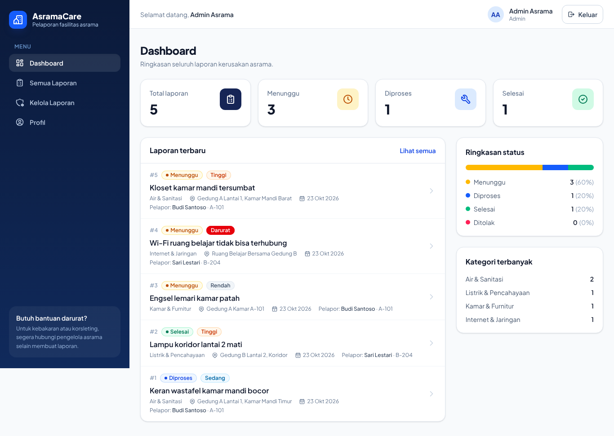
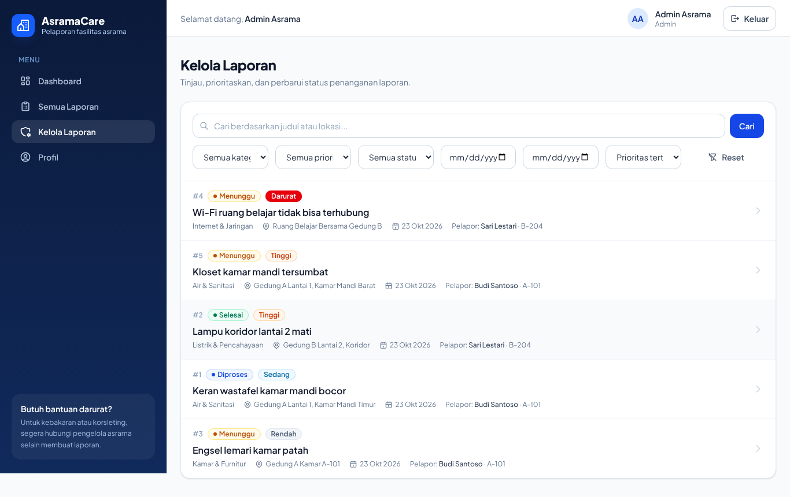
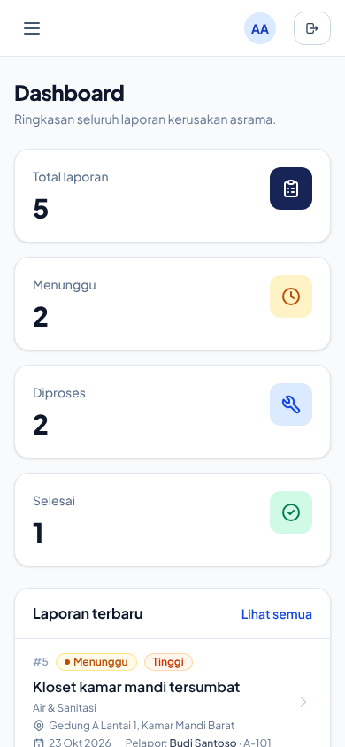

AsramaCare adalah aplikasi web pelaporan kerusakan fasilitas asrama. Penghuni membuat laporan
kerusakan, lalu admin asrama memproses, memberi catatan, dan menyelesaikan atau menolak laporan
tersebut. Repository ini berisi **front-end** (React + Redux). REST API ada di repository terpisah
[`ifs24021-pabwe2026-proyek1-backend`](https://github.com/<username>/ifs24021-pabwe2026-proyek1-backend).

Proyek 1 mata kuliah Pengembangan Aplikasi Berbasis Web (PABWE), Program Studi Sarjana Informatika,
Institut Teknologi Del, Tahun Ajaran 2026/2027.

| | |
| --- | --- |
| Disusun oleh | `[NIM]` – `[NAMA]` |
| Aplikasi (Delcom) | https://ifs24021-pabwe2026-proyek1.s1if.cloud |
| REST API (Vercel) | `https://<domain-vercel>/api` |
| Video demo | `[link YouTube]` |

## Masalah yang diselesaikan

Laporan kerusakan di asrama sering disampaikan secara lisan atau lewat grup chat, sehingga mudah
terlewat, tidak jelas statusnya, dan tidak ada riwayat penanganan. AsramaCare menyediakan satu tempat
untuk membuat laporan terstruktur (kategori, lokasi, prioritas), memantau statusnya
(Menunggu → Diproses → Selesai/Ditolak), dan melihat riwayat serta catatan tindak lanjut dari admin.

## Fitur dan peran

| Fitur | Penghuni | Admin |
| --- | :---: | :---: |
| Login, logout, registrasi akun penghuni | ✅ | ✅ (login) |
| Dashboard statistik dari database | laporan sendiri | seluruh laporan |
| Daftar laporan + pencarian, filter (kategori, prioritas, status, tanggal), urutan, pagination | ✅ | ✅ |
| Membuat laporan kerusakan | ✅ | – |
| Melihat detail + riwayat status | ✅ | ✅ |
| Mengubah/menghapus laporan sendiri selama status **Menunggu** | ✅ | – |
| Mengubah status (dengan aturan transisi) + catatan | – | ✅ |
| Menambah catatan tindak lanjut | – | ✅ |
| Menghapus laporan apa pun | – | ✅ |
| Melihat kontak pelapor (email, kamar) | hanya miliknya | ✅ |
| Profil + ganti password | ✅ | ✅ |
| Tampilan responsif (menu ponsel) | ✅ | ✅ |

Aturan transisi status: `menunggu → diproses | ditolak`, `diproses → selesai | ditolak`.
Status `selesai` dan `ditolak` bersifat final, dan penolakan wajib menyertakan alasan.

Registrasi publik **selalu** membuat akun `penghuni`. Akun admin hanya dibuat oleh seed di back-end.

Diagram use case: [`dokumentasi/use-case-asramacare.png`](dokumentasi/use-case-asramacare.png)
(sumber PlantUML: [`dokumentasi/use-case-asramacare.puml`](dokumentasi/use-case-asramacare.puml)).
Alur program: [`dokumentasi/flowchart.png`](dokumentasi/flowchart.png).

## Tangkapan layar

| Login | Dashboard penghuni | Dashboard admin |
| --- | --- | --- |
|  |  |  |

| Daftar laporan | Kelola laporan (admin) | Tampilan ponsel |
| --- | --- | --- |
|  |  |  |

## Teknologi

- React 19 (JavaScript) + Vite, dijalankan dengan **Bun**
- React Router 7 (route guard + code splitting dengan `lazy`)
- Redux Toolkit + React Redux (`createAsyncThunk`)
- Tailwind CSS v4, Tabler Icons, SweetAlert2, font Plus Jakarta Sans
- Vitest + Testing Library + jsdom untuk pengujian
- Jenkins + SonarQube + Trivy (CI/CD Delcom)

Pola kode mengikuti Modul Praktikum PABWE P4.

## Menjalankan di lokal

Prasyarat: [Bun](https://bun.sh) dan back-end AsramaCare yang berjalan di `http://localhost:3000`
(lihat README repository back-end).

```bash
git clone https://github.com/<username>/ifs24021-pabwe2026-proyek1.git
cd ifs24021-pabwe2026-proyek1
bun install
cp .env.example .env
bun run dev      # http://localhost:5173, request /api diteruskan proxy Vite ke back-end lokal
```

### Akun demo (hanya untuk development)

Dibuat oleh `npm run seed` di back-end dengan nilai dari `.env.example` back-end:

| Peran | Email | Password |
| --- | --- | --- |
| Admin | `admin@asramacare.test` | `Admin12345` |
| Penghuni | `budi@asramacare.test` | `Penghuni123` |
| Penghuni | `sari@asramacare.test` | `Penghuni123` |

Di produksi, password admin diganti lewat environment back-end.

## Environment

| Variabel | Keterangan |
| --- | --- |
| `VITE_API_BASE_URL` | URL API back-end, diakhiri `/api`. Lokal: `/api` (lewat proxy Vite). Produksi: URL back-end di Vercel, misalnya `https://ifs24021-pabwe2026-proyek1-backend.vercel.app/api`. |
| `VITE_DEV_PROXY_TARGET` | Alamat back-end lokal untuk proxy saat `bun run dev` (default `http://localhost:3000`). |

Nilai `VITE_*` dibaca saat **build**, jadi variabel ini harus diisi di environment hosting sebelum build.

## Script

| Script | Fungsi |
| --- | --- |
| `bun run dev` | Server development Vite |
| `bun run build` | Build produksi ke `dist/` |
| `bun run preview` / `bun run start` | Menyajikan hasil build |
| `bun run test` | Menjalankan seluruh pengujian Vitest |
| `bun run test:watch` | Pengujian mode watch |
| `bun run test:coverage` | Pengujian + coverage (`coverage/lcov.info`) |

## Struktur proyek

```
src/
├── app/                 # Redux store (auth, reports, dashboard) dan hooks
├── components/          # komponen umum: Navbar, Sidebar, Modal, FormField, Pagination,
│                        # StatCard, Badges, States, RouteGuards, ErrorBoundary, NotFoundPage
├── layouts/             # DashboardLayout
├── hooks/               # useInput, useThunk, useFormSubmit
├── helpers/             # apiHelper (pemanggil API), toolsHelper (label, format, validasi)
├── features/
│   ├── auth/            # login, registrasi, sesi
│   ├── dashboard/       # statistik
│   ├── reports/         # daftar, detail, buat, ubah, ubah status, catatan
│   └── users/           # profil dan ganti password
│       # tiap fitur: api/ states/ pages/ components/ modals/ layouts/
├── App.jsx              # definisi route
└── main.jsx
```

Catatan penting:

- `src/helpers/apiHelper.js` adalah pemanggil API terpusat: base URL dari `VITE_API_BASE_URL`,
  serialisasi JSON, `credentials: 'include'` agar cookie sesi ikut terkirim, normalisasi error
  (`ApiError`), dan handler 401 untuk sesi yang kedaluwarsa.
- `src/helpers/toolsHelper.js` berisi label kategori/prioritas/status, format tanggal, dan validasi
  formulir dengan aturan yang sama dengan back-end.
- `src/hooks/useThunk.js` mengubah hasil async thunk menjadi `{ ok, data }` / `{ ok: false, error }`,
  dan `src/hooks/useFormSubmit.js` menyatukan alur submit semua formulir
  (ambil nilai → validasi → kirim → tampilkan error dari server).
- `src/components/ErrorBoundary.jsx` menangkap error render (termasuk gagal memuat halaman lazy)
  agar pengguna melihat pesan yang jelas, bukan layar putih.
- `src/components/RouteGuards.jsx` berisi `RequireAuth`, `RequireRole`, dan `GuestOnly`. Guard ini
  hanya untuk pengalaman pengguna; keamanan sebenarnya ditegakkan di back-end.
- Sesi disimpan di cookie `httpOnly` yang dipasang back-end. Front-end tidak menyimpan token di
  `localStorage`, dan memulihkan sesi dengan `GET /api/auth/me` saat aplikasi dibuka.

## Route

| Path | Akses |
| --- | --- |
| `/auth/login`, `/auth/register` | tamu |
| `/` | dashboard (login) |
| `/reports`, `/reports/:id`, `/my-reports` | login |
| `/reports/new`, `/reports/:id/edit` | penghuni |
| `/profile` | login |
| `/admin/reports` | admin |
| lainnya | halaman 404 |

## Pengujian

```bash
bun run test:coverage
```

Hasil saat ini: **154 test di 37 file lulus, coverage 100%**. Setiap file test diletakkan di samping
file yang diuji (misalnya `ReportForm.jsx` → `ReportForm.test.jsx`). `src/test-utils.jsx` menyediakan
`renderWithProviders` (store Redux + router), data contoh, dan `mockApi` untuk memalsukan respons API.

## CI/CD dan deploy

`Jenkinsfile` dan `sonar-project.properties` mengikuti panduan Delcom CI/CD praktikum. Pipeline:

Checkout → Install Dependencies → Test (+ coverage) → Trivy Security Scan → SonarQube Analysis →
Quality Gate → Package → Publish → Deploy ke Delcom.

Ringkasan deploy:

1. Di Delcom buat website dengan teknologi `bun-reactjs` dan domain
   `ifs24021-pabwe2026-proyek1.s1if.cloud`, lalu isi environment
   `VITE_API_BASE_URL=https://<domain-vercel>/api`.
2. Di Jenkins buat item Pipeline dari SCM (script path `Jenkinsfile`) dengan properties
   `URL_REDEPLOY`, `URL_PROGRESS`, `DEPLOY_TOKEN`, dan `WEBSITE_ID` dari website Delcom, lalu aktifkan
   webhook GitHub ke Jenkins.
3. Di SonarQube buat proyek dengan key `ifs24021-pabwe2026-proyek1` dan webhook ke Jenkins agar tahap
   Quality Gate tidak menunggu terus.
4. Pastikan `CORS_ORIGIN` di back-end sama persis dengan domain front-end.

`vercel.json` di repository ini hanya berisi fallback SPA (`/(.*)` → `/index.html`) bila front-end
ingin dicoba di Vercel.

## Dokumentasi lain

- Naskah video demo: [`dokumentasi/naskah-video.md`](dokumentasi/naskah-video.md)
- Dokumentasi API, skema database, dan strategi autentikasi: README repository back-end
