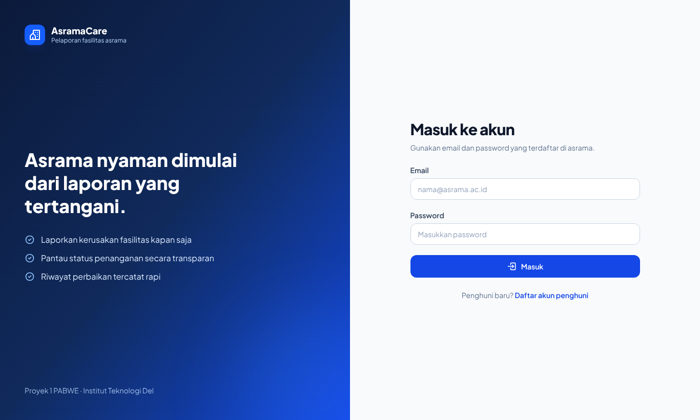
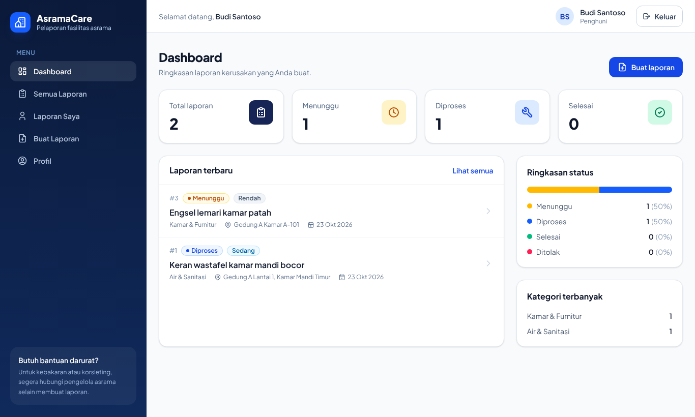
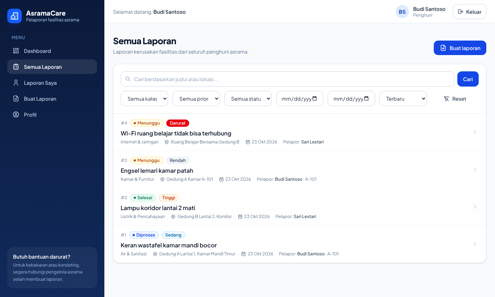
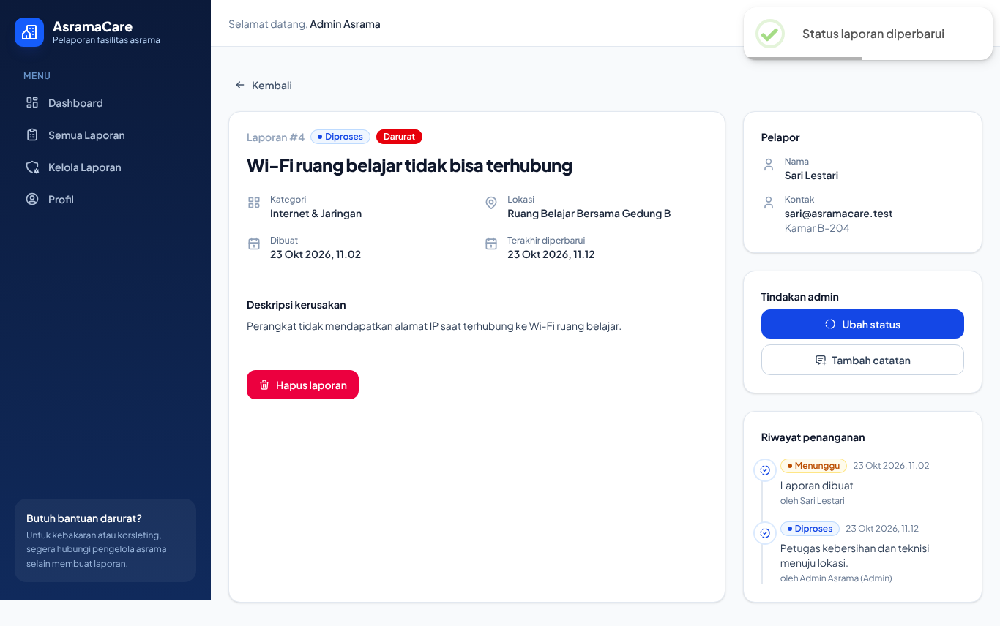

# AsramaCare — Sistem Pelaporan Kerusakan Fasilitas Asrama

AsramaCare adalah aplikasi web untuk membantu **penghuni asrama** melaporkan kerusakan fasilitas
(air, listrik, furnitur, internet, dan lainnya) dan membantu **admin/pengelola asrama** memantau,
memprioritaskan, serta mencatat proses perbaikannya.

Proyek 1 mata kuliah Pengembangan Aplikasi Berbasis Web (PABWE), dikerjakan secara individu.

## Masalah yang diselesaikan

Laporan kerusakan di asrama sering disampaikan secara lisan atau lewat grup chat, sehingga mudah
terlewat, tidak jelas statusnya, dan tidak ada riwayat penanganan. AsramaCare menyediakan satu tempat
untuk membuat laporan terstruktur (kategori, lokasi, prioritas), memantau statusnya
(Menunggu → Diproses → Selesai/Ditolak), dan melihat riwayat serta catatan tindak lanjut dari admin.

## Fitur dan peran

| Fitur | Penghuni | Admin |
| --- | :---: | :---: |
| Login, logout, registrasi akun penghuni | ✅ | ✅ (login) |
| Dashboard statistik dari database | laporan sendiri | seluruh laporan |
| Daftar laporan + pencarian, filter (kategori, prioritas, status, tanggal), urutan, pagination | ✅ | ✅ |
| Membuat laporan kerusakan | ✅ | – |
| Melihat detail + riwayat status | ✅ | ✅ |
| Mengubah/menghapus laporan sendiri selama status **Menunggu** | ✅ | – |
| Mengubah status (dengan aturan transisi) + catatan | – | ✅ |
| Menambah catatan tindak lanjut | – | ✅ |
| Menghapus laporan apa pun | – | ✅ |
| Melihat kontak pelapor (email, kamar) | hanya miliknya | ✅ |
| Profil + ganti password | ✅ | ✅ |

Aturan transisi status: `menunggu → diproses | ditolak`, `diproses → selesai | ditolak`.
Status `selesai` dan `ditolak` bersifat final. Penolakan wajib menyertakan alasan.

Registrasi publik **selalu** membuat akun `penghuni`. Akun admin hanya dibuat melalui seed
(`npm run seed`) menggunakan `ADMIN_EMAIL` dan `ADMIN_PASSWORD` dari environment.

## Teknologi

- **Front-end:** React 19 (JavaScript), Vite 8, Bun, React Router 7, Redux Toolkit + React Redux,
  Tailwind CSS v4 (`@tailwindcss/vite`), Tabler Icons React, SweetAlert2,
  Vitest + React Testing Library + user-event + jsdom + `@vitest/coverage-v8`.
- **Back-end:** Node.js 22, Express 5, SQLite melalui modul bawaan `node:sqlite` (tanpa kompilasi native), bcryptjs, jsonwebtoken,
  cookie-parser, cors, helmet, express-rate-limit, dotenv. Pengujian: Vitest + Supertest.
- **CI/CD:** Jenkins (`Jenkinsfile`), Docker (`Dockerfile`), Jenkins Delcom (webhook GitHub, Trivy, SonarQube via `sonar-project.properties`) → panel Delcom.

## Struktur folder

```
ifs24021-pabwe2026-proyek1/
├── back-end/            # REST API Express + SQLite
│   ├── src/
│   │   ├── config/      # env.js, database.js (koneksi + migrasi)
│   │   ├── controllers/ # menerima request, memanggil service
│   │   ├── middlewares/ # auth (JWT cookie), role, rate limit, error handler
│   │   ├── routes/      # definisi endpoint /api/...
│   │   ├── services/    # logika bisnis + query SQL terparameter
│   │   ├── validators/  # validasi input
│   │   ├── utils/       # AppError, konstanta, format respons
│   │   ├── app.js       # konfigurasi Express
│   │   └── server.js    # titik masuk server
│   ├── database/
│   │   ├── migrations/  # 001_init.sql
│   │   ├── seeds/       # seed.js (admin + data demo)
│   │   └── migrate.js
│   └── tests/           # pengujian endpoint (database in-memory terpisah)
├── front-end/           # React + Vite
│   └── src/
│       ├── app/store.js
│       ├── components/  # Sidebar, Navbar, Badge, Modal, State, RouteGuards, dll.
│       ├── layouts/     # DashboardLayout
│       ├── helpers/     # apiHelper.js, toolsHelper.js
│       ├── hooks/       # useInput.js
│       └── features/    # auth, users, reports, dashboard (api/states/pages/...)
├── dokumentasi/         # laporan Proyek 1, naskah video, panduan deployment, screenshot
├── Dockerfile           # image produksi satu layanan
├── Jenkinsfile          # pipeline CI/CD (dipicu webhook GitHub)
├── sonar-project.properties  # konfigurasi SonarQube
├── deploy/huggingface/  # Dockerfile + README untuk Hugging Face Spaces
└── README.md
```

## Prasyarat

- Git
- Node.js **22.13 atau lebih baru** (diuji dengan Node.js 22.22; Node 24/26 juga didukung) dan npm. Tidak perlu Visual Studio/Python karena driver SQLite memakai `node:sqlite` bawaan Node.js
- Bun **1.x** (diuji dengan Bun 1.4) — https://bun.sh

## Menjalankan di komputer lokal

### 1. Clone repository

```bash
git clone https://github.com/<username>/ifs24021-pabwe2026-proyek1.git
cd ifs24021-pabwe2026-proyek1
```

### Cara cepat (dari folder root)

```bash
bun run setup     # sekali saja: install dependensi, membuat .env, membuat database + data demo
bun run dev       # menjalankan back-end (:3000) dan front-end (:5173) sekaligus
```

Jika dependensi belum terpasang, `bun run dev` otomatis menjalankan setup terlebih dahulu.
Buka http://localhost:5173. Tekan Ctrl+C untuk menghentikan keduanya. `npm run setup` dan
`npm run dev` juga bisa dipakai. Jika ingin menjalankan masing-masing secara terpisah, ikuti
langkah 2 dan 3 di bawah.

> **Jika `bun run setup` gagal di Windows** (misalnya `EPERM` atau `node-gyp`/Visual Studio dari
> versi lama proyek ini): hapus folder `back-end\node_modules`, tutup editor/terminal lain yang membuka folder tersebut, lalu jalankan
> `bun run setup` lagi. Versi sekarang tidak memiliki dependensi native sehingga tidak butuh
> Visual Studio Build Tools. Cek versi Node dengan `node -v` (minimal 22.13).

### 2. Back-end

```bash
cd back-end
npm install
cp .env.example .env      # Windows PowerShell: Copy-Item .env.example .env
npm run seed              # membuat database SQLite, tabel, akun admin, dan data demo
npm run dev               # API berjalan di http://localhost:3000
```

Cek: buka http://localhost:3000/api/health → `{"success":true, ... "status":"ok"}`.

### 3. Front-end (terminal baru)

```bash
cd front-end
bun install
cp .env.example .env
bun run dev               # aplikasi berjalan di http://localhost:5173
```

Vite meneruskan (proxy) semua request `/api` ke `http://localhost:3000`, sehingga cookie sesi
bekerja tanpa konfigurasi tambahan.

### Akun demo (hanya untuk development)

Dibuat oleh `npm run seed` dengan nilai dari `.env.example`:

| Peran | Email | Password |
| --- | --- | --- |
| Admin | `admin@asramacare.test` | `Admin12345` |
| Penghuni | `budi@asramacare.test` | `Penghuni123` |
| Penghuni | `sari@asramacare.test` | `Penghuni123` |

Di produksi, ganti `ADMIN_EMAIL`/`ADMIN_PASSWORD` dan set `SEED_DEMO=false`.

## Database SQLite

- File database: `back-end/data/asramacare.db` (diatur lewat `DB_PATH`).
- Migrasi (`database/migrations/*.sql`) dijalankan otomatis saat server/seed membuka database dan
  dicatat di tabel `schema_migrations`, sehingga aman dijalankan berulang.
- `npm run migrate` hanya menjalankan migrasi; `npm run seed` menjalankan migrasi + seed (idempoten).
- Reset database lokal: hentikan server, hapus `back-end/data/asramacare.db*`, lalu `npm run seed`.

Skema: `users`, `reports`, `report_history` dengan foreign key (`ON DELETE CASCADE`),
constraint `CHECK` untuk role/kategori/prioritas/status, dan indeks pada `reporter_id`, `status`,
`created_at`, dan `report_history.report_id`.

## Environment variables

### back-end/.env

| Variabel | Default | Keterangan |
| --- | --- | --- |
| `NODE_ENV` | `development` | `production` mewajibkan `JWT_SECRET` ≥ 32 karakter |
| `PORT` | `3000` | Port server |
| `DB_PATH` | `./data/asramacare.db` | Lokasi file SQLite (di hosting: volume persisten, mis. `/data/asramacare.db`) |
| `JWT_SECRET` | – | Rahasia tanda tangan JWT |
| `JWT_EXPIRES_IN` | `1d` | Masa berlaku token |
| `CORS_ORIGIN` | `http://localhost:5173` | Origin yang diizinkan, pisahkan dengan koma |
| `COOKIE_SAMESITE` | `lax` | `none` jika front-end dan back-end beda domain |
| `COOKIE_SECURE` | `false` | `true` di produksi (HTTPS) |
| `ADMIN_NAME`, `ADMIN_EMAIL`, `ADMIN_PASSWORD` | – | Akun admin awal untuk seed |
| `SEED_DEMO` | `true` | Membuat penghuni + laporan demo |
| `STATIC_DIR` | `../front-end/dist` | Folder build React yang disajikan Express (opsional) |

### front-end/.env

| Variabel | Default | Keterangan |
| --- | --- | --- |
| `VITE_API_BASE_URL` | `/api` | Base URL API. Isi URL lengkap jika back-end di domain lain |
| `VITE_DEV_PROXY_TARGET` | `http://localhost:3000` | Target proxy Vite saat development |

File `.env` tidak ikut di-commit (lihat `.gitignore`).

## Strategi autentikasi

- Password di-hash dengan **bcrypt** (10 salt rounds); hash tidak pernah dikirim ke klien.
- Setelah login, server mengirim **JWT di cookie `httpOnly`** (`SameSite=Lax`, `Secure` di produksi).
  JavaScript di browser tidak dapat membaca token, sehingga token tidak tersimpan di `localStorage`
  dan lebih tahan terhadap pencurian lewat XSS.
- Front-end memanggil `GET /api/auth/me` saat aplikasi dibuka untuk memulihkan sesi.
- **Logout** menghapus cookie di server (`POST /api/auth/logout`). Token bersifat stateless dan
  kedaluwarsa otomatis sesuai `JWT_EXPIRES_IN`.
- Middleware `authenticate` mengambil ulang data pengguna dari database di setiap request, sehingga
  akun yang dihapus langsung kehilangan akses. Middleware `authorize('admin')` membatasi endpoint admin.
- Respons 401 dari endpoint terlindungi memicu status "sesi berakhir" di front-end dan mengarahkan ke
  halaman login dengan pesan.
- Login dibatasi 20 percobaan / 15 menit per IP (`express-rate-limit`). Pesan gagal login sama untuk
  email salah maupun password salah.

## REST API

Semua respons berbentuk `{ "success": boolean, "message": string, "data"?: object, "errors"?: object }`.

| Method | Endpoint | Akses | Keterangan |
| --- | --- | --- | --- |
| GET | `/api/health` | publik | Status API dan database |
| POST | `/api/auth/register` | publik | Registrasi penghuni |
| POST | `/api/auth/login` | publik | Login, memasang cookie sesi |
| POST | `/api/auth/logout` | publik | Menghapus cookie sesi |
| GET | `/api/auth/me` | login | Pengguna aktif |
| GET | `/api/users/me` | login | Profil |
| PUT | `/api/users/me` | login | Ubah nama/kamar |
| PUT | `/api/users/me/password` | login | Ganti password |
| GET | `/api/users` | admin | Daftar pengguna + jumlah laporan |
| GET | `/api/reports` | login | Daftar laporan. Query: `q`, `category`, `priority`, `status`, `dateFrom`, `dateTo` (YYYY-MM-DD), `sort` (`newest`/`oldest`/`priority`), `mine=true`, `page`, `limit` (≤50) |
| GET | `/api/reports/stats` | login | Statistik (admin: semua, penghuni: miliknya) |
| POST | `/api/reports` | login | Buat laporan (status selalu `menunggu`, pelapor = pengguna aktif) |
| GET | `/api/reports/:id` | login | Detail + riwayat |
| PUT | `/api/reports/:id` | pemilik | Ubah laporan selama `menunggu` |
| DELETE | `/api/reports/:id` | pemilik/admin | Pemilik hanya saat `menunggu`, admin kapan saja |
| PATCH | `/api/reports/:id/status` | admin | `{ status, note }` sesuai aturan transisi |
| POST | `/api/reports/:id/notes` | admin | `{ note }` catatan tindak lanjut |

Kode status: 200, 201, 400 (validasi), 401, 403, 404, 409 (konflik/transisi tidak sah), 413, 500.
Detail kesalahan internal hanya dicatat di log server, tidak dikirim ke klien.

Contoh:

```bash
curl -c cookie.txt -H "Content-Type: application/json" \
  -d '{"email":"budi@asramacare.test","password":"Penghuni123"}' \
  http://localhost:3000/api/auth/login
curl -b cookie.txt "http://localhost:3000/api/reports?status=menunggu&sort=priority"
```

## Pengujian

```bash
# back-end
cd back-end
npm test                 # 82 test endpoint & database
npm run test:coverage    # laporan coverage di back-end/coverage/

# front-end
cd front-end
bun run test             # 134 test komponen, halaman, state, helper, App
bun run test:coverage    # laporan coverage di front-end/coverage/
```

Pengujian back-end memakai database SQLite **in-memory baru untuk setiap test**, sehingga tidak
menyentuh `data/asramacare.db`. Pengujian front-end memakai `fetch` tiruan (tidak butuh server).

Hasil terakhir (dijalankan saat pengembangan):

| Bagian | Test | Statements | Branches | Functions | Lines |
| --- | --- | --- | --- | --- | --- |
| Back-end | 82 lulus | 100% | 100% | 100% | 100% |
| Front-end | 134 lulus | 100% | 100% | 100% | 100% |

## Build dan deployment

```bash
cd front-end && bun run build     # hasil di front-end/dist
cd ../back-end
NODE_ENV=production JWT_SECRET=<rahasia-panjang> STATIC_DIR=../front-end/dist npm start
```

Pada mode ini Express menyajikan API di `/api` dan aplikasi React di path lainnya (satu origin, satu URL).
`Dockerfile` di root membangun image produksi yang sama. Deployment utama: Jenkins Delcom (dipicu webhook GitHub)
menjalankan test, Trivy, SonarQube, lalu mengirim `latest-app.zip` ke panel Delcom yang menjalankan
`npm install` + `npm start` di root. Alternatif: Hugging Face Spaces (`deploy/huggingface/`). Panduan lengkap ada di [dokumentasi/deployment.md](dokumentasi/deployment.md).

## Status artefak pengumpulan

| Artefak | Status |
| --- | --- |
| Kode front-end & back-end | ✅ selesai, test lulus |
| Dokumen Proyek 1 (template) | ✅ draf terpisah dari repository, beberapa isian pribadi perlu dilengkapi |
| Repository GitHub | ⏳ perlu di-push oleh pemilik (lihat perintah di dokumentasi/deployment.md) |
| Pengujian Jenkins | ⏳ `Jenkinsfile` siap (trigger webhook GitHub), perlu dijalankan di server Jenkins |
| URL aplikasi online | ⏳ https://ifs24021-pabwe2026-proyek1.s1if.cloud (Delcom) — perlu redeploy dan verifikasi |
| Video YouTube | ⏳ naskah di `dokumentasi/naskah-video.md` |

## Tangkapan layar

| Login | Dashboard penghuni |
| --- | --- |
|  |  |
| **Daftar laporan** | **Detail laporan (admin)** |
|  |  |

Flowchart alur program: [dokumentasi/flowchart.png](dokumentasi/flowchart.png) · Use case diagram: [dokumentasi/use-case-asramacare.png](dokumentasi/use-case-asramacare.png) (sumber PlantUML: `dokumentasi/use-case-asramacare.puml`)
